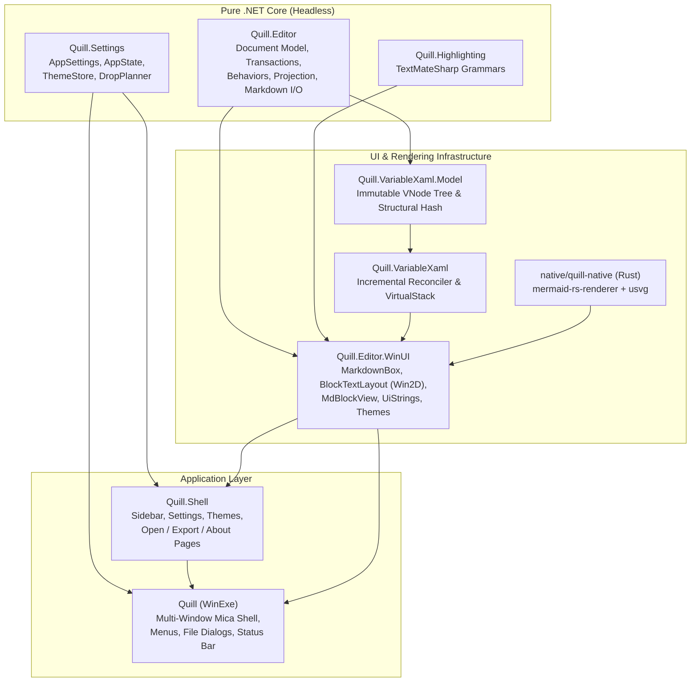

<p align="center">
  
</p>

<h1 align="center">Quill</h1>

<p align="center">
  A native WYSIWYG Markdown editor for Windows 11, built with C#, .NET 10, WinUI 3, and Win2D.
</p>


<p align="center">
  <strong>English</strong> · <a href="README.zh-CN.md">简体中文</a> · <a href="docs/en/architecture.md">Architecture (EN)</a> · <a href="docs/README.md">架构文档 (中文)</a>
</p>

---

## Overview

**Quill** delivers a Typora-style, single-pane *what-you-see-is-what-you-write* Markdown editing experience directly on top of the native Windows UI and Direct2D/DirectWrite graphics stack.

The entire editor core lives in a pure `.NET 10` library (`Quill.Editor`) with zero UI framework dependencies, driving an immutable document tree, reversible transactions, and lossless Markdown round-tripping. A custom incremental XAML reconciler (`Quill.VariableXaml`) and Direct2D text engine (`Quill.Editor.WinUI`) project only what changed directly into virtualized WinUI containers.

## Key Features

- **Native WYSIWYG & Source Mode**: Inline syntax reveals seamlessly when the caret enters formatted spans (`**bold**`, `` `code` ``, `$math$`, `[links](url)`) and hides cleanly elsewhere; press `Ctrl+/` to switch to syntax-highlighted Markdown source mode at any time.
- **Lossless Markdown Round-Tripping**: Markdig is strictly encapsulated inside the importer. Quill's own `MarkdownSerializer` replays original line endings, encoding/BOM, blank-line separators, indentation prefixes, and list/heading styles so unedited regions remain byte-for-byte identical.
- **Direct2D/Win2D Custom Text Rendering**: `BlockTextLayout` and `MdBlockView` render text with CSS half-leading baseline stability, pixel-snapped offscreen targets (eliminating glyph jitter during selection drags), ligature-safe UTF-16 grapheme cluster navigation, and ClearType antialiasing.
- **Rich Embedded Content**:
  - **Math**: TeX inline and display equations via native `RaTeX` + bundled KaTeX fonts (no JavaScript).
  - **Mermaid Diagrams**: Native Rust sidecar (`quill_native.dll` powered by `mermaid-rs-renderer` + `usvg`) converting Mermaid source to path-resolved SVG for Direct2D.
  - **Syntax Highlighting**: Code fences and source mode powered by `TextMateSharp`.
  - **Tables, Task Lists, Footnotes & Images**: Interactive table resize/alignment toolbar, image drag-and-drop/paste with configurable asset rules, live hover previews, and clickable TOC/outline navigation.
- **Live Bilingual UI (English & 简体中文)**: Runtime localization via `UiStrings` with instant, zero-restart switching across all open windows, menus, sidebars, settings, and dialogs.
- **Customizable Theme Studio**: 85 granular theme slots (`MdStyleSheet` + `StyleSlots`) with built-in GitHub Light and GitHub Dark Dimmed themes, live side-by-side preview, and JSON user themes.
- **Unpackaged Windows 11 Desktop App**: Native extended Mica title bar, multi-window shared settings/state stores (`JsonStore<T>`), outline & file-tree sidebar, auto-save, and external disk-change detection.

## Architecture at a Glance



## Repository Structure

| Path | Description |
| :--- | :--- |
| `src/Quill.Editor` | Pure `.NET 10` document engine: immutable block tree, grapheme/selection geometry, commands, reversible transactions/steps, behaviors, memoizing projector, and lossless Markdown importer/serializer. |
| `src/Quill.VariableXaml.Model` | Immutable virtual node model (`VNode`), incremental XAML markup parser, and structural hashing (`IStructuralHash`). |
| `src/Quill.VariableXaml` | Incremental XAML tree reconciler (`VariableXamlRoot`, `Reconciler`) and collection virtualization bridges (`VirtualStackHandler`). |
| `src/Quill.Highlighting` | Thread-safe TextMateSharp grammar catalog and token span classifier for code blocks and source mode. |
| `native/quill-native` | Rust library (`cdylib`) rendering Mermaid source to Direct2D-friendly simplified SVG via `mermaid-rs-renderer` and `usvg`. |
| `src/Quill.Editor.WinUI` | `MarkdownBox` input/IME adapter (`CoreTextEditContext`), `BlockStackLayout` virtualization, Win2D self-drawn controls, RaTeX/Mermaid/image pipelines, 85-slot theme model, and bilingual `UiStrings`. |
| `src/Quill.Settings` | Pure `.NET 10` persistence for settings, window state, theme diff files, image insertion macros, and Explorer "New" menu integration. |
| `src/Quill.Shell` | Reusable WinUI feature pages and sidebar controls (`OutlinePanel`, `FilesPanel`, `SettingsPage`, `ThemesPage`, `ThemeEditorPage`, `OpenPage`, `ExportPage`). |
| `src/Quill` | Main unpackaged WinUI 3 application (`WinExe`, `WindowsPackageType=None`) tying multi-window chrome, menus, and file dialogs together. |
| `src/Quill.Playground` | Prototype host and headless/off-screen WinUI self-test harness (`--selftest`). |
| `tests/` | Pure `.NET` unit, property, and invariant tests (`Quill.Editor.Tests`, `Quill.Settings.Tests`). |
| `scripts/` | Build, icon generation, off-screen self-test runner, and release packaging scripts. |
| `docs/` | Detailed architecture documentation ([English Overview](docs/en/architecture.md) · [中文深入文档](docs/README.md)). |

## Prerequisites

- **Windows 11 (x64)**
- **.NET 10 SDK** (`10.0.402`, pinned in [global.json](global.json))
- **Visual Studio 2022 / Visual Studio Insiders** (MSBuild + MSVC toolchain)
- **Rust toolchain** (`x86_64-pc-windows-msvc`) for building `native/quill-native`
- **Windows App SDK 2.5.1** (restored via NuGet)

## Build, Test & Package

Run all commands inside a Visual Studio Developer PowerShell (`Launch-VsDevShell.ps1 -Arch amd64 -HostArch amd64`):

```powershell
# Build the entire solution (Unified Visual Studio layout: bin/<Configuration>/<tfm>/)
dotnet build Quill.slnx -c Debug -nologo

# Build the desktop app via helper script
pwsh -NoProfile -File scripts/build-app.ps1 -Configuration Debug

# Run pure .NET unit & invariant test suites
dotnet test tests/Quill.Editor.Tests/Quill.Editor.Tests.csproj -nologo
dotnet test tests/Quill.Settings.Tests/Quill.Settings.Tests.csproj -nologo

# Run off-screen WinUI integration & localization self-tests (never steals focus)
pwsh -NoProfile -File scripts/run-selftest.ps1 -Configuration Debug -TimeoutSeconds 300

# Create an unpackaged x64 Release zip package (Windows App SDK self-contained, .NET 10 framework-dependent)
pwsh -NoProfile -File scripts/publish-release.ps1 -Version 0.1.0
```

## Documentation

- **English**: [System Architecture Overview](docs/en/architecture.md)
- **简体中文（自底向上系统架构解析）**: [文档目录](docs/README.md)
  1. [01 - 全局概览与核心不变量](docs/01-overview.md)
  2. [02 - 不可变文档树与零损耗 Markdown I/O](docs/02-document-model-and-markdown-io.md)
  3. [03 - 编辑状态、命令分发与可逆事务语义](docs/03-editor-state-and-operations.md)
  4. [04 - 增量投影与 VariableXaml UI 协调引擎](docs/04-projection-and-variable-xaml.md)
  5. [05 - Win2D 自绘排版、公式、图表与块级控件](docs/05-rendering-and-elements.md)
  6. [06 - 输入管线、IME 组合、查找替换与性能工程](docs/06-input-ime-and-performance.md)
  7. [07 - 设置持久化、85 槽主题、运行时双语热切换与应用外壳](docs/07-settings-themes-and-app-shell.md)

## Third-Party Notices

See [THIRD-PARTY-NOTICES.md](THIRD-PARTY-NOTICES.md) for licenses of bundled KaTeX fonts and open-source dependencies.

## License

Quill is licensed under the [MIT License](LICENSE).
