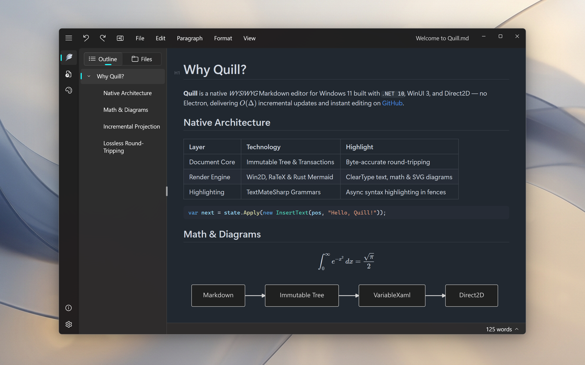
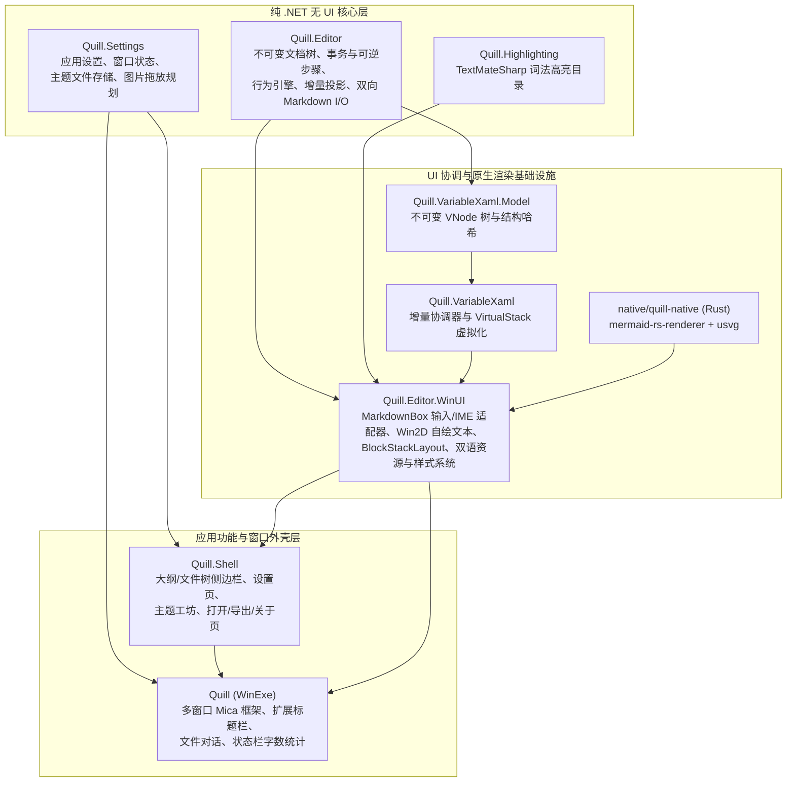

<p align="center">
  
</p>

<h1 align="center">Quill</h1>

<p align="center">
  基于 C#、.NET 10、WinUI 3 与 Win2D 构建的 Windows 11 原生所见即所得 Markdown 编辑器
</p>


<p align="center">
  <a href="README.md">English</a> · <strong>简体中文</strong> · <a href="docs/README.md">系统架构文档 (中文)</a> · <a href="docs/en/architecture.md">Architecture (EN)</a>
</p>

<p align="center">
  <picture>
    <source media="(prefers-color-scheme: dark)" srcset="docs/assets/preview-dark.png" />
    <source media="(prefers-color-scheme: light)" srcset="docs/assets/preview-light.png" />
    
  </picture>
</p>

---

## 项目简介

**Quill** 旨在为 Windows 11 提供对标 Typora 的单栏所见即所得（WYSIWYG）Markdown 编辑体验。与基于 Electron / WebView2 的编辑器不同，Quill 构建在 .NET 10 与原生 Direct2D / DirectWrite 图形栈之上。

项目的核心编辑器逻辑（`Quill.Editor`）完全脱离 WinUI 运行，采用不可变树形文档模型、可逆操作事务以及零损耗双向 Markdown 解析/序列化；UI 层通过自研增量协调器（`Quill.VariableXaml`）与虚拟化布局器（`BlockStackLayout`），仅重算和更新文档中实际发生变化的节点与可视区域控件。

## 核心特性

- **原生所见即所得与源码双模式**：光标进入加粗、行内代码、数学公式、超链接等行内样式时即时显隐 Markdown 语法标记；随时通过 `Ctrl+/` 无缝切换至带语法高亮的 Markdown 源码模式。
- **零损耗 Markdown 往返读写**：Markdig 严格隔离于导入阶段内部；导出由自研 `MarkdownSerializer` 完成，精确重放原文档换行符、编码与 BOM、空行分隔、列表标记、标题样式及前置行前缀，未编辑片段逐字节原样保留。
- **Win2D / Direct2D 自绘文本排版引擎**：`BlockTextLayout` 与 `MdBlockView` 实现了类似 CSS `half-leading` 的稳定基线对齐、基于物理整像素离屏缓冲区的无抖动选区渲染、UTF-16 字素簇（Grapheme）光标对齐，以及原生 ClearType 字体抗锯齿。
- **富媒体内嵌与异步渲染**：
  - **数学公式**：基于原生 `RaTeX` 与内置 KaTeX 字体渲染行内及块级 TeX 公式（无 JS 运行时）。
  - **Mermaid 流程图/时序图**：自研 Rust 原生库 `quill_native.dll`（`mermaid-rs-renderer` + `usvg`），将图元与文字转为 Direct2D 可直接绘制的纯路径 SVG。
  - **代码高亮**：集成 `TextMateSharp`，支持代码块与源码模式异步语法高亮。
  - **表格、任务列表、脚注与图片**：浮动表格工具栏与行列拖动调整、图片粘贴/拖放规则与路径宏展开、悬浮定义预览及大纲/TOC 目录联动跳转。
- **零重启中英双语热切换**：内置 `UiStrings` 运行时本地化引擎，在设置页切换 `English` / `简体中文` 时，所有打开窗口的菜单、侧边栏、弹窗、主题项及编辑器元素立即同步更新。
- **85 槽位主题系统**：内置 GitHub 浅色与 GitHub Dark Dimmed 主题，支持实时对比预览、按分组搜索及增量 Diff JSON 用户主题定制。
- **非打包式（Unpackaged）Windows 11 桌面架构**：Mica 扩展标题栏、多窗口共享设置与状态存储、大纲与文件树侧边栏、自动保存及磁盘外部修改提示。

## 整体架构图



## 构建、测试与打包

请在 **Visual Studio Developer PowerShell**（通过 `Launch-VsDevShell.ps1 -Arch amd64 -HostArch amd64` 初始化环境）中执行以下命令：

```powershell
# 全解决方案构建（统一使用 Visual Studio 默认目录结构 bin/<Configuration>/<tfm>/）
dotnet build Quill.slnx -c Debug -nologo

# 单独构建主应用
pwsh -NoProfile -File scripts/build-app.ps1 -Configuration Debug

# 运行纯 .NET 单元测试与性质测试
dotnet test tests/Quill.Editor.Tests/Quill.Editor.Tests.csproj -nologo
dotnet test tests/Quill.Settings.Tests/Quill.Settings.Tests.csproj -nologo

# 运行离线/离屏 WinUI 集成与多语言热切换自测（绝不抢占前台焦点）
pwsh -NoProfile -File scripts/run-selftest.ps1 -Configuration Debug -TimeoutSeconds 300

# 生成非打包 x64 Release 发布包（.NET 10 框架依赖 + Windows App SDK 自包含）
pwsh -NoProfile -File scripts/publish-release.ps1 -Version 0.1.0
```

## 架构文档导航

从最底层的文档树与位置/事务代数语义，到增量投影、Win2D 图形绘制及顶层多窗口壳体：

- **中文深入系列**：[查看完整中文文档目录](docs/README.md)
  1. [01 - 全局概览、依赖约束与工程结构](docs/01-overview.md)
  2. [02 - 不可变文档模型、字素边界与零损耗 Markdown I/O](docs/02-document-model-and-markdown-io.md)
  3. [03 - EditorState、光标与选区模型、命令分发与可逆事务](docs/03-editor-state-and-operations.md)
  4. [04 - 双阶段增量投影与 VariableXaml UI 协调引擎](docs/04-projection-and-variable-xaml.md)
  5. [05 - Win2D 自绘排版引擎、公式/图表/高亮与块级控件树](docs/05-rendering-and-elements.md)
  6. [06 - 输入管线、IME 组合、局部查找替换与滚动性能工程](docs/06-input-ime-and-performance.md)
  7. [07 - 配置存储、85 槽主题系统、双语热切换与应用壳体](docs/07-settings-themes-and-app-shell.md)
- **English Summary**: [System Architecture Overview](docs/en/architecture.md)

## 第三方许可声明

内置 KaTeX 字体与开源依赖项许可请见 [THIRD-PARTY-NOTICES.md](THIRD-PARTY-NOTICES.md)。

## 许可证

Quill 基于 [MIT 许可证](LICENSE) 开源。
