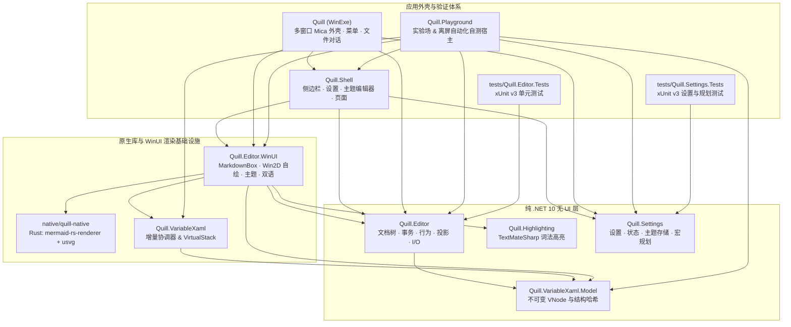

# 01 - 全局概览、架构约束与工程结构

## 1.1 为什么采用原生 WinUI 3 + Win2D 路线

**Quill** 在架构设计之初即确立了**无 WebView（No WebView）**的核心目标：

- **图形层直连 Direct2D / DirectWrite**：所有文本块（段落、标题、表格单元格、代码块、数学公式、目录与辅助装饰）均由 `Microsoft.Graphics.Canvas`（Win2D）在显存纹理上自绘，使用硬件加速与原生 ClearType 字形抗锯齿，无任何浏览器引擎或 DOM 树。
- **核心算法无头化（Headless Core）**：文档模型、编辑状态机、可逆事务系统、语法序列化和增量投影算法全部封装于纯 `.NET 10` 程序集 `Quill.Editor` 中，使其能够不依赖窗口和 UI 线程运行成千上万项单元测试与不变量属性测试。
- **单向增量数据流**：编辑行为不直接修改任何可视化控件属性，而是先驱动纯内存状态迁移，再将变化部分以虚拟节点树（`VNode`）补丁的形式精确落地到视口内真正挂载的 WinUI 对象上。

---

## 1.2 核心架构不变量（Hard Invariants）

整个代码库围绕以下五条不可违背的工程约束构建：

| 不变量 | 约束内容 | 验证手段与代码防线 |
| :--- | :--- | :--- |
| **1. 核心与 UI 绝对隔离** | `Quill.Editor`（`net10.0`）严禁引用 `Microsoft.UI.*`、`Windows.*` 或 Win2D 命名空间。 | `Quill.Editor.csproj` 无 WinUI SDK；`Quill.Editor.Tests` 包含架构边界守卫测试。 |
| **2. Markdig 严禁泄漏** | `Markdig` 仅作为导入时的语法结构扫描器，严禁将其 AST 类型暴露到公共模型或序列化路径中。 | `Quill.Editor/Markdown/Import/` 为 `internal` 封装；导出完全由自研 `MarkdownSerializer` (`BlockWriter`) 负责。 |
| **3. 单一真相与单向数据流** | `EditorSession.State`（`EditorState`）是编辑期唯一权威状态源，所有键鼠/IME/菜单操作必须经由 `Command` 流转。 | `MarkdownBox` 仅投递 `Command`（如 `InsertText`、`MoveCaret`、`SetSelection`），自身不持久化正文内容。 |
| **4. 不可变树与结构共享** | 所有块节点与状态记录均为 C# `record`，集合采用 `ImmutableList<Block>` 与 `ImmutableArray<LinePrefix>`。 | 编辑某一叶子节点时，只复制其至 `Document` 根的路径；未改动的兄弟子树引用相等（`ReferenceEquals == true`）。 |
| **5. 零 $O(N)$ 按键开销** | 常规键入与撤销/重做过程中，全篇重新解析与全篇重新序列化的次数必须严格为 `0`。 | `OperationCounters` 对 `FullDocumentParse`、`FullDocumentSerialization` 与 `FullProjection` 计数拦截。 |

---

## 1.3 解决方案拓扑与依赖分层

`Quill.slnx` 包含 **9 个源代码项目**、**2 个测试项目**，并协同构建 **1 个 Rust 原生动态库（`native/quill-native`）**：

### 各工程职责一览

| 工程 | 目标框架 | 文件 / 代码规模 | 核心职责 |
| :--- | :--- | :--- | :--- |
| `src/Quill.VariableXaml.Model` | `net10.0` | 14 files / 1,825 LOC | 定义不可变 `VNode`、`VAttribute`、`VPropertyElement`、`IStructuralHash` 及增量 XAML 解析/书写模型。 |
| `src/Quill.Editor` | `net10.0` | 138 files / 19,591 LOC | 核心编辑领域引擎：文档树模型、位置/选区、命令与行为、可逆步骤、增量投影、I/O、统计与搜索。 |
| `src/Quill.Highlighting` | `net10.0` | 5 files / 646 LOC | 线程安全的 TextMateSharp 语法目录（`GrammarCatalog`）、语言别名映射及暗/亮双色词法分类。 |
| `src/Quill.Settings` | `net10.0` | 23 files / 1,548 LOC | 原子 JSON 存储 `JsonStore<T>`、`AppSettings`、`AppState`、稀疏主题差量存储 `ThemeStore` 及拖放规则规划器。 |
| `native/quill-native` | Rust `2024` (`cdylib`) | 1 file (`lib.rs`) / 143 LOC | C ABI 导出 `quill_mermaid_render`，将 Mermaid 文本渲染并经由 `usvg` 矢量化为路径 SVG。 |
| `src/Quill.VariableXaml` | `net10.0-windows10.0.19041.0` | 23 files / 3,899 LOC | `VariableXamlRoot` 与 `Reconciler` 增量 Diff/Patch 引擎、XAML 类型元数据 schema 及虚拟容器适配器。 |
| `src/Quill.Editor.WinUI` | `net10.0-windows10.0.19041.0` | 95 files / 13,699 LOC | `MarkdownBox`、TSF/IME 输入控制器、Win2D 自绘控件体系、RaTeX 公式排版、85 槽样式表、中英双语表。 |
| `src/Quill.Shell` | `net10.0-windows10.0.19041.0` | 29 files / 3,604 LOC | 独立于窗口的功能界面库：大纲/文件侧边栏、设置页、主题列表与编辑器、打开/导出/关于页。 |
| `src/Quill` | `net10.0-windows10.0.19041.0` (`WinExe`) | 14 files / 2,018 LOC | 主桌面程序入口（`WindowsPackageType=None`），负责多窗口生命周期、Mica 扩展标题栏、文件监视、自动保存与弹窗。 |
| `src/Quill.Playground` | `net10.0-windows10.0.19041.0` (`WinExe`) | 72 files / 13,370 LOC | 原型实验与无焦点离屏 WinUI 自测宿主（`--selftest`）。 |
| `tests/Quill.Editor.Tests` | `net10.0` | 71 files / 9,023 LOC | 不依赖窗口的编辑器全量测试、往返模糊对比与性质测试。 |
| `tests/Quill.Settings.Tests` | `net10.0` | 7 files / 805 LOC | 设置持久化、图片宏替换、拖放计划与资源管理器注册表测试。 |

---

## 1.4 统一构建目录与原生 Sidecar 联编机制

- **Visual Studio 统一产物结构**：所有工程已统一采用 `PlatformTarget=x64`（可执行工程显式配置）与 `AnyCPU` 平台解决方案结构，编译输出统一归集于 `bin/<Configuration>/<TargetFramework>/`（不再区分 `bin/x64/` 与 `bin/Debug/` 双份冗余输出）。
- **Rust Sidecar 自动构建**：在 `Quill.Editor.WinUI.csproj` 中定义了 MSBuild Target `BuildQuillNative`（`BeforeTargets="AssignTargetPaths"`），当 `native/quill-native/src/**/*.rs`、`Cargo.toml` 或 `Cargo.lock` 发生变更时自动触发 `cargo build --release`，并将 `quill_native.dll` 作为 `Content` 随应用输出至根目录。
- **KaTeX 原生字体资产**：20 个 KaTeX TrueType 字体随 `Quill.Editor.WinUI/Assets/KaTeX/**` 拷贝到输出目录，供 `RaTeX` 公式引擎进行精确的字形度量排版与渲染。
