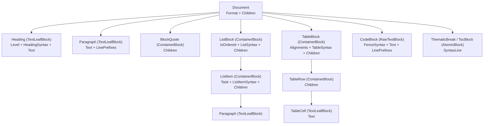

# 02 - 不可变文档模型、字素边界与零损耗 Markdown I/O

本章解析最底层的数据结构 `Quill.Editor.Documents`、`Quill.Editor.Text` 与 `Quill.Editor.Markdown`，回答两个核心问题：
1. Quill 如何在内存里同时承载**结构化富文本块层级**与**未展开的原始行内 Markdown 源码**？
2. 为什么修改文档中的某一段文字时，文档其余 99% 的结构可以在导出时**逐字节保持原样**？

---

## 2.1 双层数据表示：块树 + 叶子源码（Block Tree + Leaf Source）

传统纯文本编辑器只有字符串，富文本树难以高效维护；而传统重度 AST 编辑器会把每一个 `**bold**`、`` `code` `` 都拆成永久的对象树节点，导致行内编辑跨标签光标极难处理，且导出时极易破坏用户原有的 Markdown 书写习惯（例如把 `*` 强制改写为 `-`、重写链接引用风格或合并空行）。

Quill 采用的是 **「块级建树，叶子存源码」** 的混合不可变模型（定义于 [Block.cs](../../src/Quill.Editor/Documents/Block.cs)）：

### 节点基类体系

1. **`Block`（抽象基记录 `abstract record`）**
   - `BlockId Id`：唯一稳定的块标识，由 `IBlockIdSource`（运行时及测试用 `SequentialBlockIdSource`）分配。节点内容修订后 `Id` 保持不变，用于增量投影缓存命中及选区锚定。
   - `long Revision`：记录该节点最后一次被修改时的文档修订版本号。
   - `BlockSeparator? SeparatorBefore`：记录该块与前一个兄弟块之间的空行元数据（行数、每行的原始空白/引用前缀 `>` 等）。若为 `null`，表示结构新增块，导出时按规范自动生成。
2. **`ContainerBlock`（容器块）**
   - 仅持有 `ImmutableList<Block> Children`，典型实现见 [ContainerBlocks.cs](../../src/Quill.Editor/Documents/ContainerBlocks.cs)：`Document`、`BlockQuote`、`ListBlock`、`ListItem`、`TableBlock`、`TableRow`、`FootnoteDefinition`、`LinkReferenceDefinition`。
3. **`LeafBlock`（叶子块）**
   - 核心字段为 `string Text`：存储标准化为 `\n` 换行符的块内容文本。
   - `ImmutableArray<LinePrefix> LinePrefixes`：记录 `Text` 中第 $k$ 个物理行前面的容器前缀（例如外层引用块留下的 `> `、有序列表项续行的缩进空格），用于多行容器内的字节级原样重放。
   - 细分为两类：
     - **`TextLeafBlock`**：`Text` 中包含行内 Markdown 语法，在编辑/投影期间由内联解析器按 `InlineSyntaxSet`（`Full`、`FootnoteContent`、`PlainText`）动态切分：`Paragraph`、`Heading`、`TableCell`、`CodeLanguage`、`DefinitionSlot`（[TextBlocks.cs](../../src/Quill.Editor/Documents/TextBlocks.cs)）。
     - **`RawTextBlock`**：`Text` 不做行内 Markdown 语法隐藏：包括 `CodeBlock`（代码块正文）、`MathBlock`（`$$...$$` 公式块）、`HtmlBlock`（原生 HTML 块）、`FrontMatter`（YAML 头信息）、以及源码模式专用的 `SourceLine`（[RawBlocks.cs](../../src/Quill.Editor/Documents/RawBlocks.cs)）。
4. **`AtomicBlock`（原子块）**
   - 无可编辑文本内容，作为一个整体呈现与选中：`ThematicBreak`（水平分隔线 `---`/`***`/`___`）与 `TocBlock`（`[toc]` 目录占位块），保留原始整行文本 `SyntaxLine`。

---

## 2.2 不可变持久化更新与结构共享

当通过 `DocumentTree.Replace` 或 `ReplaceChildrenStep` 修改某一个叶子块时（例如在 `b42` 中输入一个字符）：

- 仅创建新的叶子节点 `b42'`，并通过 `with` 表达式沿其父链向上逐层创建新父节点，直达新根节点 `Document'`，递增 `Revision`。
- 文档内其余全部未受影响的兄弟分支（容器与叶子）直接复用原有不可变对象实例引用，内存分配严格正比于**树深 $O(\text{depth})$** 而非文档大小 $O(N)$。

同时，`DocumentIndex`（按 `BlockId` 索引父路径）与 `HeadingIndex`（按版本增量追踪全篇标题目录树与深度）基于不可变树快照提供 $O(1)$ / 均摊低开销的节点寻址和目录检索，而无需线性扫描整棵树。

---

## 2.3 UTF-16 字素簇安全边界（Grapheme Cluster Safety）

WinUI 与 .NET 字符串均以 UTF-16 码元（Code Unit）寻址，但现代文档普遍包含 Emoji（如合成肤色/家庭图标，含代理对与 ZWJ）、中文生僻字扩展区字符（高/低代理对 `char`）以及带变音符号的组合字符序列。一旦光标或选区落在一个字素簇内部，输入、退格或渲染选区都将造成字符截断甚至乱码。

为此，Quill 在 `Quill.Editor.Text.TextBoundaries` 中以 `System.Globalization.StringInfo.GetNextTextElementLength` 确立一条铁律：

- `NextGrapheme(text, offset)` 与 `PreviousGrapheme(text, offset)` 永远只跨越完整的字素簇，并显式将 `\n` 视作独立簇，避免跨行扫描开销。
- `SnapToGrapheme(text, offset)` 保证任意来自外部 API、选区映射或鼠标命中测试的偏移量，在写入 `EditorState` 前被稳定对齐至不越界的字素簇边界。
- 词边界导航（`NextWord`、`PreviousWord`、`WordRangeAt`）同样在字素边界之上运作，兼容英文标识符、连续标点及中文分词直观跳跃。

---

## 2.4 语法元数据与行前缀拼接机制

节点记录的不只是语义，还包括原文语法：

- **`HeadingSyntax`**：记录 ATX 标题（`#` 的数量及尾部闭合 `#` 与空白）或 Setext 下划线标题（`===`/`---` 的字符、长度与前缀）。
- **`FenceSyntax` / `CodeBlockSyntax`**：记录围栏符号是反引号 `` ` `` 还是波浪线 `~`、围栏长度（3 个及以上）、info string 前后空格、闭合围栏是否存在；或区分缩进代码块（4 空格/制表符）。
- **`ListSyntax` / `ListItemSyntax`**：记录列表标记字符（`-`/`*`/`+` 或 `.`/`)`）、松散/紧凑标记 `WasLoose`、`Start` 起始编号，以及与前一个同类型列表之间是否原本分隔（`SeparateFrom`），确保局部增删列表项时不会错误合并相邻独立列表或改写原列表符号。
- **`TableSyntax` / `TableRowSyntax`**：保留管道符风格、对齐分隔符行的原始宽度与空格分布，避免未修改过的表格因为重序列化而发生整表对齐重排。

当用户在引用块（`> line1\n> line2`）或缩进列表内修改某一叶子的文本、按回车换行或退格删行时，`LinePrefixSplice`（`Quill.Editor/Transactions/LinePrefixSplice.cs`）只对受影响范围的 `ImmutableArray<LinePrefix>` 进行增量切片替换，插入的新行继承容器默认前缀，而被删除的旧行前缀精确保存进可逆 `Step` 中，以便 `Undo` 时逐字符还原。

---

## 2.5 双向 Markdown I/O 与文件编码保真

### 导入流程（`MarkdownImporter`）

位于 [MarkdownImporter.cs](../../src/Quill.Editor/Markdown/MarkdownImporter.cs)：
1. `LineEndings.Normalize` 扫描原始全文，记录文档主要换行风格（`CrLf` / `Lf`）、是否存在混合换行 `HasMixedLineEndings` 及末尾是否有换行符，并将内存统一标准化为 `\n`。
2. 调用内部 `Markdig.Markdown.Parse(..., MarkdigPipelines.Import)`（开启精确源位置追踪、YAML Front Matter、数学块、表格、任务列表、脚注等扩展）。
3. `BlockConverter` **直接依据 Markdig 给出的字节/字符偏移区间（`SourceSpan`）从原始输入字符串 `SourceText` 切片抽取叶子的原始文本、行前缀与块间 `BlockSeparator`**，而不使用 Markdig 内部渲染器。对于不支持的复杂原生扩展结构，保留诊断信息并降级为可编辑的原始块，绝不静默丢弃用户数据。

### 导出流程（`MarkdownSerializer`）

位于 [MarkdownSerializer.cs](../../src/Quill.Editor/Markdown/MarkdownSerializer.cs)：
1. 若处于源码模式（`SourceText.IsSource(document)`），直接拼接 `SourceLine` 文本零解析导出。
2. 否则由完全自研的 `BlockWriter` 递归遍历文档树：
   - 已有 `SeparatorBefore` 与 `LinePrefixes` 的节点原样重放；
   - 仅当块被编辑导致结构不一致，或是新插入的节点时，才按上下文约束合成合规 Markdown 语法；
   - 最后通过 `LineEndings.Apply` 恢复原文件的 `\r\n` 或 `\n` 样式。
3. 文件级别读写通过 `MarkdownFile` 与 `MarkdownFileCodec` 处理 **UTF-8（带/不带 BOM）、UTF-16 LE、UTF-16 BE、GB18030 及系统默认传统代码页**。保存时若检测到旧代码页无法容纳新输入的 Unicode 字符（如中文或 Emoji），自动安全回退升级为 UTF-8 并向 UI 报告编码变更警告（`WarnEncodingChangedAsync`），避免写入乱码损坏文件。
