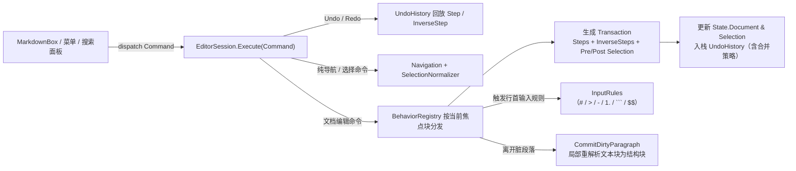

# 03 - EditorState、光标与选区模型、命令与可逆事务

本章深入 `Quill.Editor.State`、`Quill.Editor.Commands`、`Quill.Editor.Transactions`、`Quill.Editor.Behaviors` 与 `Quill.Editor.Editing`，阐明编辑器是如何通过严格的**单一状态机 + 可逆代数事务**控制一切编辑语义的。

---

## 3.1 EditorState：单一权威快照

在任何时刻，编辑器内的完整语义都封装在一个不可变对象 [EditorState.cs](../../src/Quill.Editor/State/EditorState.cs) 中：

| 字段 | 类型 | 职责说明 |
| :--- | :--- | :--- |
| `Document` | `Document` | 当前不可变文档树根节点（含最新 `Revision` 与 `DocumentFormat`）。 |
| `Selection` | `TextSelection` | 当前光标（折叠选区）或选区（锚点 `Anchor` 与活动端 `Head`），且保证已经过 `SelectionNormalizer` 字素对齐。 |
| `Composition` | `Composition?` | 正在进行中的输入法（IME）组合区间：`BlockId`、`Start`、`Length` 以及组合期间冻结的 `ActivationHead`。 |
| `GoalX` | `double?` | 上下方向键连续纵向移动光标时记忆的期望横坐标，一旦执行横向或文本编辑命令立即清空。 |
| `Interaction` | `Interaction` | UI 瞬态交互信号：`HasFocus`、`IsPointerDown`、`FrozenActivationHead`（鼠标拖拽选区期间冻结活动范围，避免语法标记突然展开导致字符位置跳变！）、`HoverTarget`。 |

### 为什么需要 `ActivationHead` 冻结？

在所见即所得模式下，当光标滑入 `**加粗**` 附近时，`*` 星号会展开显示，导致该行文字视觉右移。试想用户正在鼠标拖动选择文字，如果刚拖过某个标记就开始闪出隐藏字符，光标下方的字符坐标就会瞬间漂移，使拖拽框选彻底失控！

`EditorState.ActivationHead` 优雅地解决了这一顽疾：

```csharp
public Position ActivationHead =>
    Interaction.FrozenActivationHead ?? Composition?.ActivationHead ?? Selection.Head;
```

- 指针按下拖拽选区期间（`IsPointerDown == true`）或输入法拼音候选未上屏期间（`Composition != null`），`ActivationHead` 始终锁定在交互起点，视图内已有文本排版稳如磐石；松手或上屏瞬间再平滑切换激活上下文。

---

## 3.2 位置（Position）与 Affinity 亲和力模型

Quill 定义了两类互补的文档位置模型（见 [Positions.cs](../../src/Quill.Editor/State/Positions.cs)）：

1. **`TextPosition(BlockId Block, int Offset, Affinity Affinity = Affinity.Forward)`**
   - 落在某个 `LeafBlock.Text` 的内部，以 UTF-16 码元计数且强制落在字素簇边界上。
   - **双向 `Affinity` 消歧义**：在 Markdown 源码中，`**foo**|`（粗体标记外侧）与 `**foo|**`（粗体标记内侧），在视觉上都表现为字母 `o` 的右侧；在软折行行尾与下一行行首之间也有同一物理索引对应两个视觉坐标的问题。`Affinity.Backward` 表示紧贴前一字符/行内样式内部（显示标记），`Affinity.Forward` 表示处于后继上下文或标记外部，使键盘左右穿行、自动括号输入和行尾光标显示完全符合用户直觉。
2. **`BoundaryPosition(BlockId Parent, int Index)`**
   - 位于某个容器块第 `Index` 个子块之前（`Index == parent.Children.Count` 表示末尾），用来锚定跨块选区的起止端点，以及表达虚段落占位符或原子块边界。
3. **`TextSelection.BlockCaret(Parent, Index)`**
   - 专门用于 `ThematicBreak`（分割线）或 `TocBlock`（目录）等**无文本原子块**的特殊光标态（`IsBlockCaret = true`）：它覆盖该原子块前后边界，只允许执行 `Backspace` / `Delete` 删除块或方向键/Enter 跳出，渲染层则为其绘制整体选中边框，而非文本竖线光标。

---

## 3.3 命令系统与行为注册表（Commands & Behaviors）

所有对编辑器的操作（键盘、鼠标、右键菜单、顶部菜单栏、查找替换、粘贴与拖放）全部抽象为不可变命令派生记录 [Commands.cs](../../src/Quill.Editor/Commands/Commands.cs)：

- **文本微操作**：`InsertText`、`DeleteBackward(Unit)`、`DeleteForward(Unit)`、`InsertSoftBreak`、`SplitBlock`、`SplitBlockAlternate`（Ctrl+Enter 跳出块或提交段落）、`Indent` / `Outdent`
- **导航与选区**：`MoveCaret(Direction, Unit, Extend)`、`SetSelection`、`SelectAll`、`SelectWord`、`SelectBlock`、`SelectScope`、`SelectLine`
- **排版与格式**：`ToggleInline(InlineFormat)`（Bold / Italic / Underline / Code / InlineMath / Strikethrough / Superscript / Subscript / Highlight / Keyboard / Comment）、`InsertLink`、`InsertImage`、`ClearFormat`、`SetHeadingLevel`、`ChangeHeadingLevel`、`ToggleBlock(Quote / Code / Math)`、`ToggleList(Ordered / Unordered / Task)`、`InsertBlock(Rule / Toc / FrontMatter)`
- **表格操作**：`InsertTable(Cols, Rows)`、`EditTable(TableEdit)`（插行/列、上下左右移动行列、删除行列、格式化表源码、删表）、`SetColumnAlignment`、`ResizeTable`
- **高级操作**：`ReplaceMatch` / `ReplaceAllMatches`、`ToggleTaskItem`、`SetCodeLanguage`、`ReloadDocument`、`Undo` / `Redo`、`PasteContent`、`CopySelection` / `CutSelection`

### 执行管线



不同容器与叶子对同一快捷键具有不同语义（例如按 `Tab` 在列表项中缩进、在表格单元格中跳转下一格、在代码块中插入缩进空格或制表符、在代码语言标签里跳回代码区等）。`BehaviorRegistry` 将这些差异清晰拆解到 `TextBehavior`、`TableCellBehavior`、`ListItemBehavior`、`BlockQuoteBehavior`、`CodeLanguageBehavior`、`DefinitionSlotBehavior`、`SourceLineBehavior`、`BlockCaretBehavior` 与 `VirtualParagraphBehavior` 等独立策略类中，彼此解耦、极易单测。

---

## 3.4 可逆事务与 Undo/Redo 代数语义

任何修改文档的编辑最终都要落成 [Transaction.cs](../../src/Quill.Editor/Transactions/Transaction.cs)：

- **`Steps` 与 `InverseSteps`**：每个原子修改步骤 `Step`（如 `ReplaceTextStep`、`ReplaceChildrenStep`、节点元数据更新等，见 [Steps.cs](../../src/Quill.Editor/Transactions/Steps.cs)）在 `Apply(document, revision, out Step inverse)` 时**同时计算出其绝对精确的逆步骤**。
  - 例如 `ReplaceTextStep` 不只记录替换前后的字符串，还捕获了 `removed` 行前缀数组和编辑起点原本的 `LinePrefix`，因此撤销时可以把一行原本缩进空格不同的空行精确还原到字节级一模一样。
- **`Step.Map(Position, before, after)`**：当撤销栈需要重映射光标位置，或跨事务追踪定位时，`Map` 将文档修改前的坐标代数映射至修改后的坐标。
- **精细化撤销合并策略（`TransactionKind`）**：
  - `Typing` 与 `Deletion`：若在短时间窗口内、同一 `EditedBlock` 上连续单向键入/删除（如输入一个完整英文单词），自动合并为同一条撤销记录（`UndoHistory`）。
  - `InputRule`：在段落开头输入 `# `、`> `、`- [ ] `、` ``` ` 等触发块转换时，先保留用户刚输入文本的事务，再紧接着提交一条独立的 `TransactionKind.InputRule` 事务 —— 这样用户按一次 `Ctrl+Z` 可以先**撤销转换回到 `# foo` 纯文本状态**，再按一次才删字符。
  - `Commit`：当用户输入了一段未通过输入规则触发、但本身构成新块语法（例如粘贴多行源码或手动修改分隔线文本后将光标移出当前块）并离开时，触发局部段落提交重解析（`MarkdownImporter.ImportFragment`），绝不会导致全篇 re-parse，同样作为独立可撤销步骤记录。
  - **输入法组合保护（`Composition`）**：处于 `StartComposition` -> `UpdateComposition` 期间的临时拼音过程只更新预览选区且暂不进入持久化历史，待 `CommitComposition` 时整合成一次干脆的 `TransactionKind.Composition`。
