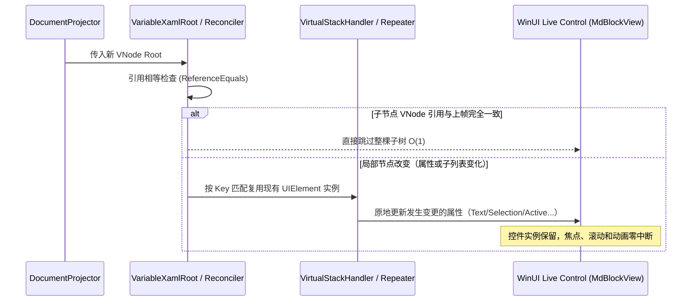

# 04 - 双阶段增量投影与 VariableXaml UI 协调引擎

从状态层（`Quill.Editor`）到桌面界面（`WinUI 3`）之间，横亘着两个核心工程难题：
1. 每次光标移动、闪烁或单个字符输入，如何**不重建整个文档树对应的几十万个 UI 节点**？
2. 当界面控件属性确实需要修改时（例如某个段落从普通段落升级成一级标题，或展开了行内语法标记），如何在**不销毁原生 WinUI 控件、不丢失 Focus / Selection / 滚动偏移**的前提下原地更新？

本章剖析负责桥接这两者的双引擎：**`DocumentProjector`** 与 **`VariableXaml`**。

---

## 4.1 DocumentProjector：纯函数式双阶段备忘录投影

[DocumentProjector.cs](../../src/Quill.Editor/Projection/DocumentProjector.cs) 实现映射：

$$\text{Project}(\text{EditorState}) \longrightarrow (\text{VNode Root},\; \text{PositionMap},\; \text{ActiveSet},\; \text{SelectionInfo},\; \text{ProjectionStatistics})$$

它的核心优化被称为 **双阶段备忘录投影（Two-Phase Memoized Projection）**：

### 阶段一：视图状态与局部脏节点判定

1. **计算激活上下文（`Activation.Compute`）**：依据 `state.ActivationHead` 确定光标落在哪一块、哪一对行内修饰符或超链接之中，以及是否激活代码块语言标签 / TOC / 数学公式块预览，得出 `ActiveSet`。
2. **比对块级视图状态（`ViewStates.Compute`）**：每个块有一个轻量的 `BlockViewState`（自身是否激活、内部选区起止偏移、是否整体选中、活跃行内区间等）。`DocumentProjector` 对比上一帧 `_states` 与当前 `_current`：
   - 仅当块本身的不可变引用变动（`block.Revision` 改变）、其 `BlockViewState` 变动、所依赖的脚注/链接定义标签发生变化（由 `_leavesByLabel` 精准追踪引用失效集合）、或 TOC 受全局 `HeadingIndex` 版本更新影响时，才将该块及其祖先加入 `_mustVisit` 集合！
3. **快速就地路径（In-Place Short-Circuit）**：
   - 若仅移动了光标而并未跨出同一块，也未触及激活状态变化，`_mustVisit.Count == 0` 直接复用整个 `_rootChildren` 数组；
   - 若仅顶层某几个相邻块发生了轻量编辑（例如正在正文中连续打字），`TryProjectTopLevelInPlace` 直接原地替换数组中的那 1~2 个顶层槽位，`Document` 其余数千个顶层 `VNode` 引用原封不动（零复制遍历）。

### 阶段二：叶子内联重算与 VNode 生成

只有进入 `_mustVisit` 且内容确实修改的文本叶子块，才会重新运行内联解析器（`InlineTrees`）并在内存构建新的不可变 `VNode` 与单块偏移映射 `BlockPositionMap`。

---

## 4.2 PositionMap：源码偏移 ↔ 显示偏移双向精准映射

在所见即所得模式下，文档原始字符和屏幕实际画出来的字符往往不等长：

- 光标未激活 `**hello**` 时：原文长度为 `9`，屏幕显示为 `hello`（显示长度 `5`）；
- 光标一旦跨入或靠近，隐藏标记展开，原文与显示偏移重新变成 `1:1`；
- 行内数学公式 `$E=mc^2$`、行内图片 `` 或 HTML 实体在折叠态时会投影为一个单独的对象占位符 **`U+FFFC` (`ObjectReplacementCharacter`)**（占 1 个 UTF-16 显示码元）。

`BlockPositionMap`（[PositionMap.cs](../../src/Quill.Editor/Projection/PositionMap.cs)）以分段映射表（`SegmentKind`：原样可见段 / 折叠隐藏段 / 单字符对象替换段）精确建立：
- **Source → Display**：将文档选区 `Anchor`/`Head`、`IMatchSource` 查找高亮区间、以及输入法 `Composition` 范围实时转化为绘制控件直接消费的显示偏移；
- **Display → Source**：将指针命中测试（Hit Testing）、DirectWrite 点击偏移转化为编辑模型严格遵循的原文偏移，连同 `Affinity` 决定光标站在隐式标记之内还是之外。

---

## 4.3 VariableXaml.Model：轻量不可变虚拟节点树

不同于一般手写繁琐 UI Adapter 的做法，Quill 构建了一套通用的声明式 XAML 虚拟 DOM 模型库 —— `Quill.VariableXaml.Model`：

- **`VNode`**（`Element` / `Text` / `Collection`）：不可变虚节点，`Key`（如 `"b42"`）标识块身份，`TypeName`（如 `ProjectionNames.Paragraph` -> `MdParagraph`）对应真实 WinUI 控件类型，另有不可变属性表与子节点数组。
- **`IStructuralHash`**（[IStructuralHash.cs](../../src/Quill.VariableXaml.Model/Model/IStructuralHash.cs)）：对于诸如 `SelectionInfo`、`HoverInfo`、`TocContent` 等传给控件的非标量复杂属性对象，提供稳定结构哈希，避免引用不同但内容相同的结构触发无谓更新。

---

## 4.4 VariableXamlRoot & Reconciler：参考级跳过的 WinUI 补丁器

`Quill.VariableXaml` 将虚拟树以最小 DOM Mutation 方式协调到 WinUI 真实对象树中（[VariableXamlRoot.cs](../../src/Quill.VariableXaml/VariableXamlRoot.cs)）：

### 核心优化细节

1. **参照跳过与类型 Schema 元数据**：`XamlSchema` 预构建各自定义控件的可设置属性（`XamlMemberInfo`）与子集容器映射，无需在热路径重复反射查找。属性仅当值或结构哈希真正不相等时才写入 WinUI 依赖属性或 CLR 属性。
2. **`VirtualStack` 虚拟化桥接**：顶层 `vx:VirtualStack` 不直接创建几千个控件堆到普通 `StackPanel` 上，而是经由 `VirtualStackHandler` 和 `VirtualItemCollection` 对接 WinUI `ItemsRepeater`。当滚动发生或单块修改时，仅发细粒度集合变更通知（Add / Remove / Replace），由底层虚拟化布局按需向 `IVirtualLifecycle` 派生控件分发复用、回收与彻底卸载清理通知（`UnmountBlock`）。
3. **帧内合并（Coalescing）与同步控制**：一般模式可通过 `DeferUpdates = true` 在 Dispatcher 单帧内合并更新；在 `MarkdownBox` 内部为保障按键到视图坐标同步（ScrollIntoView / Caret / IME BoundingBox 查询立刻有效），设 `DeferUpdates = false`，由 `MarkdownBox` 在完成命令批处理后显式精确推入。
