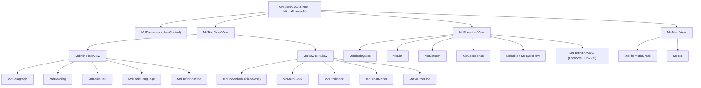

# 05 - Win2D 自绘排版、公式、图表与块级控件

本章深入 `Quill.Editor.WinUI` 的视觉呈现层（`Elements/`、`Text/`、`Rendering/`）以及外部语法/图像渲染模块（`Quill.Highlighting`、`native/quill-native`）。正是这一层让 Quill 彻底摆脱了对 WebView 和 DOM 的依赖。

---

## 5.1 MdBlockView 体系与 ClearType 消抖绘制架构

所有可视化文档块均继承自抽象控件 [MdBlockView.cs](../../src/Quill.Editor.WinUI/Elements/MdBlockView.cs)（直接派生自 `WinUI Panel` 并实现 `IVirtualLifecycle`）。

### 绘制宿主分工与不透明 ClearType

- **单画布托管（Single Canvas Host）**：对于能独立绘制的叶块或容器，`MdBlockView(draws: true)` 拥有一个不截断点击（`IsHitTestVisible = false`）的 Win2D `CanvasVirtualControl`。嵌套的子节点（如 `MdTableCell` 内的文字、列表项头文字）可以通过 `FindDrawingHost()` 经由容器统一代理绘制（`DrawDelegated`），避免为表格里几百个小单元格各自分配一套独立 D2D 虚拟表面开销。
- **不透明清屏与 ClearType**：每个画布以祖先继承链 `BlockContext` 提供的 `Surface`（如页面背景色、引用底色或代码块灰底色）进行不透明填充后绘制字体，确保 Windows DirectWrite 启用高质量 RGB 次像素 ClearType 抗锯齿，而不是混合透明 Alpha 的发虚灰度字形。
- **物理整像素离屏缓冲（零选区闪烁策略）**：Win2D `CanvasVirtualControl`（底层为 DX `VirtualSurfaceImageSource`）在发生瓦片异步重绘时，系统提供的 `DrawingSession.Transform` 平移原点会随视口瓦片图集槽位偏移变化，如果直接在其上绘制，拖拽选区高亮时相邻未改动字形会发生轻微亚像素抖动（Shimmer / Flicker）。`MdBlockView.Draw` 采用了一套高精度对齐管线：
  1. 按真实物理 DPI 缩放比 `scale = dpi / 96f`，将逻辑脏区域精确向外取整吸附到物理整像素边界（`Floor`/`Ceiling` 得到 `pxWidth × pxHeight`）。
  2. 在与 `(0, 0)` 原点对齐的离屏 `CanvasRenderTarget` 上执行文本与背景绘制（DirectWrite 始终以稳定原点进行像素吸附，字形零偏移）；若区域超出硬件最大纹理尺寸则安全降级直绘。
  3. 再用最近邻点采样（`CanvasImageInterpolation.NearestNeighbor`）与覆盖混合模式（`CanvasComposite.Copy`）严丝合缝回填到虚拟画布瓦片上，彻底根除拖拽选区时的文字视觉微颤。
- **反引用循环卸载（`UnmountBlock`）**：当块离开虚拟列表回收池被永久卸载时，`UnmountBlock()` 解绑 `RegionsInvalidated` 委托并显式调用 `canvas.RemoveFromVisualTree()`，主动断开 Win2D 原生 C++ 对象（`m_lastSeenParent`）与托管 `.NET` 控件之间的跨边界引用环，防止长期滚动后托管对象无法被 GC 回收。

---

## 5.2 BlockTextLayout 与长文本分段排版

位于 [BlockTextLayout.cs](../../src/Quill.Editor.WinUI/Text/BlockTextLayout.cs)（实现 `ITextBlockLayout`）：

1. **`TextSource` 与 `U+FFFC` 对象字符**：从投影层生成的显示字符串、样式区间（`TextSpan`：粗斜体、下划线、删除线、等宽字体、前后景色、括号/代码/键盘框样式）以及行内对象（`TextObject`：行内数学公式、图片、Emoji、HTML 实体，各在字符串中占一个 `''`即 `U+FFFC`）。
2. **CSS `half-leading` 等高基线稳定性**：当文档中没有嵌入式内联高对象时，`BlockTextLayout` 计算标准字号行高 `EmptyLineHeight` 与字体真实上伸/下沉部之和 `Ascent + Descent`，将多出来的半行距均分到上下方（`emptyBaseline = Ascent + (EmptyLineHeight - (Ascent + Descent)) / 2`），并以 `CanvasLineSpacingMode.Uniform` 锁定全段行高和基线。这样即使光标进出行内代码或 `**加粗**` 标记引发局部等宽字体或回退字体混排，整行基线和上下行距纹丝不动！如果行内嵌入了高图片或公式，则安全切换回 `Proportional` 模式以防止对象被上下截断。
3. **基于字形墨迹包裹的行内边框**：传统按 em-box 绘制 `` `inline code` `` 背景框时上下会显得过高，容易与上下行文字紧挨。`BlockTextLayout` 查询每个字体规格实际墨迹测量框并缓存入并发字典 `InkMetricCache`，结合主题中的 `InlineCornerRadius`、`CodePadding` 和边框绘制出视觉紧凑贴合的行内代码块及 `<kbd>` 键盘徽章。
4. **超长代码/原始文本分片引擎（`PiecewiseTextLayout`）**：对于包含数千行的超大代码块或 Front Matter，[PiecewiseTextLayout.cs](../../src/Quill.Editor.WinUI/Text/PiecewiseTextLayout.cs) 按每 **64 物理行（`LinesPerPiece = 64`）** 切分为垂直堆叠的独立 `BlockTextLayout` 分片。编辑其中某一行仅重新实例化并排版受影响的那 1 个分片（严格满足复杂度独立于代码总行数的约束），绘制时跳过视口/脏矩形外的无关分片。

---

## 5.3 原生数学公式排版（RaTeX + KaTeX 字体）

Quill 通过 `RaTeX 1.0.0` 原生库与随程序发布的 20 份 KaTeX `.ttf` 字体资产，提供无浏览器环境下的专业 LaTeX 公式渲染（见 [MathTypesetter.cs](../../src/Quill.Editor.WinUI/Rendering/Formulas/MathTypesetter.cs)）：

- **`MathTypesetter`**：内部维护一个容量为 **512 条的 LRU 缓存**（键为 `(TeX 源码, Display/Inline 模式)`），命中缓存时直接返回预先布局完成的 `DisplayList`。
- **预热加载**：`MarkdownBox` 构造函数启动后台预热 `MathTypesetter.WarmUp()`，防止用户在首次打开含公式文档时在 UI 线程支付初次 DLL 初始化开销。
- **渲染器（`MathRenderer`）**：直接读取 `DisplayList` 的字符字形与分式横线/根号几何指令在 Win2D `CanvasDrawingSession` 上矢量化绘制。若公式语法存在错误（例如漏写右花括号），行内或公式块会保持显示源码、将错误原因通过悬停提示（`AdornerLayer`）与错误高亮色展现出来，同时允许用户无缝修改修正。

---

## 5.4 原生 Mermaid 图表渲染 Sidecar（Rust + usvg）

为了在彻底不嵌入 Chromium/Node.js 的情况下直接渲染 Mermaid 流程图/时序图/类图等，Quill 自主集成了一层极简高效的 Rust 动态链接库 `native/quill-native`：

- **渲染管线（[lib.rs](../../native/quill-native/src/lib.rs)）**：
  1. 跨 C ABI 导出函数 `quill_mermaid_render` 接收 UTF-8 Mermaid 源码与明/暗主题标志，并使用 `std::panic::catch_unwind` 隔离所有潜在 Rust panic 防止击穿 CLR 进程。
  2. 调用 `mermaid-rs-renderer::render_with_options` 生成基础 SVG（强行将背景色设为 `transparent`，使其天然贴合文档卡片当前表面色调）。
  3. 将该初步 SVG 喂入 `usvg::Tree::from_str`，并配置系统字体库单次惰性缓存（`OnceLock<Arc<usvg::fontdb::Database>>`，优先匹配 `Segoe UI`、`Times New Roman`、`Cascadia Mono` 并支持中英文 `en`/`zh-CN` 回退）以及禁止外部网络/磁盘引用解析器。
  4. 由 `usvg` 将全部 CSS 样式级联消解并把矢量字体转换为标准 `<path>` 轮廓几何数据写出，确保输出结果**只包含 Direct2D 原生支持的 SVG 最小子集**。
- **C# 调度封装**：WinUI 侧通过 `MermaidNative` 调用 P/Invoke（并由 `quill_buffer_free` 安全释放 Rust 堆分配缓冲区），借助 `DispatcherRenderScheduler` 在后台线程异步执行图布局，随后交由 Win2D `CanvasSvgDocument` 光栅化嵌入页面，避免任何阻塞 UI 帧率的行为。

---

## 5.5 语法高亮与异步图片加载

### 代码与源码双引擎高亮

- **`Quill.Highlighting`（纯 .NET）**：内置线程安全的 `GrammarCatalog`（在全局锁下按需懒加载 `TextMateSharp.Grammars` 的 Light+ 与 Dark+ 两套配色方案和数几十种语言词法定义），经 `LanguageMap` 自动规范化常见的围栏语言简写（如 `cs`、`py`、`ts`、`yml`、`bash`、`md` 等）。
- **增量状态高亮（`CodeHighlighter` & `MarkdownHighlighter`）**：TextMate 词法状态机是跨行递推的。修改代码块第 $k$ 行时，仅从第 $k$ 行的前置状态继续向下重新扫描直至后续行的行末状态栈收敛与原历史状态相等（早期终止），且 `CodeHighlighting` 在 UI 层维持 32 条局部最近高亮缓存并后台预加载语言包，彻底免去首帧等待。
- **源码模式时间片调度（`SourceHighlighting`）**：面对几万行巨型文件切换源码模式时，借助时间预算分段着色并分帧回填可见行颜色。

### 本地与远程图片加载（`ImageLoader` & `RemoteImages`）

- 支持相对路径（相对于当前文档目录 `MarkdownBox.DocumentDirectory`）、绝对本地路径与 HTTP/HTTPS 远程 URL；解码后的位图（`CanvasBitmap`）及失效状态由 `ImageLoader` 按文档路径与 URI 管理生命周期并响应重新布局测量。
