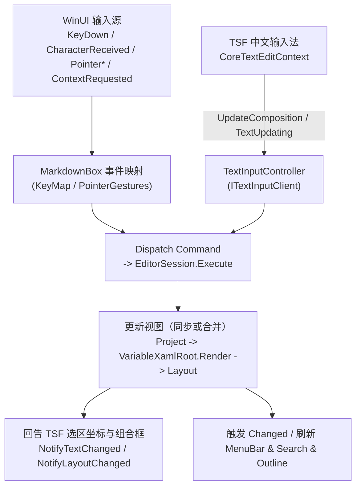

# 06 - 输入管线、IME 组合、查找替换与滚动性能工程

本章解析核心控件容器 [MarkdownBox.cs](../../src/Quill.Editor.WinUI/MarkdownBox.cs) 如何接管所有输入与编辑体验（键盘、指针、IME 中文输入法、右键/顶部菜单、拖放、查找替换及源码模式），并重点揭示 Quill 在**超长文档下持续稳定内存与零卡顿滚动**的布局调度算法。

---

## 6.1 MarkdownBox：输入适配器的总控中心

与传统借助不可见 `<TextBox>` 代理输入的富文本技巧不同，`MarkdownBox` 直接继承 `UserControl` 并开启 `IsTabStop = true`，围绕**不篡改状态**原则运转：

### 输入事件分工

- **键盘指令分流**：`OnKeyDown` 查询无 UI 的标准按键映射表（`KeyMap`），翻译成 `MoveCaret`、`DeleteBackward`、`ToggleInline`、`Indent`、`Undo`/`Redo`、`Search`（`Ctrl+F`/`Ctrl+H`）或源码切换（`Ctrl+/`）。普通可打印字符统一由 `OnCharacterReceived` 接收并组装代理对（高代理字符暂存于 `_highSurrogate`，与紧接的低代理字符拼接成完整汉字扩展区或 Emoji 再投递 `InsertText`）。
- **指针手势引擎（`PointerGestures`）**：通过 `XamlLayoutService` 提供的几何命中测试精准转换屏幕坐标至 `Position`（含双点击选词、三击选段、拖拽过程中冻结 `FrozenActivationHead`、以及 `Ctrl+Click` 激发 `LinkActivated` 跳转文档外链接或文内锚点 `GoToAnchor` / 脚注往返 `GoToFootnoteDefinition`）。
- **只读与动态禁用**：支持 `IsReadOnly`（用于主题编辑页的右侧实时对比预览区 `ThemePreview`），此时跳过键盘写入与文本服务激活。

---

## 6.2 CoreTextEditContext 与中文输入法（TSF / IME）架构

对于非打包桌面 WinUI 3 应用（`WindowsPackageType=None`），直接与 Windows 文本服务框架（TSF）的 `CoreTextEditContext` 协作是输入法兼容性的关键战场。Quill 从实践中沉淀了两项至关重要的稳定性机制（见 [CoreTextServiceContext.cs](../../src/Quill.Editor.WinUI/Input/CoreTextServiceContext.cs) 与 [TextInputController.cs](../../src/Quill.Editor.WinUI/Input/TextInputController.cs)）：

1. **单例化复用 `CoreTextEditContext`**：Windows 规定同一线程下的非打包应用不应在每次控件加载、切页或新开文档时频繁呼叫 `CoreTextServicesManager.GetForCurrentView().CreateEditContext()` 制造孤儿上下文，否则极易出现输入法候选框滞留在旧页面、无法呼出中文键盘或底层 COM 对象撕裂。`CoreTextServiceContext` 通过全局创建并允许 `SetController` 动态重绑控制器，在当前视图的多个 `MarkdownBox` 切换甚至切到主题设置再回来时无损复用。
2. **重入锁（`IsUpdating`）延迟调和与防循环**：
   - 当 TSF 向 `TextInputController` 同步回调 `TextUpdating`、`SelectionUpdating` 或 `CompositionCompleted` 时，控制器置位 `_updating = true`；
   - `MarkdownBox` 在命令执行后的视图更新阶段检测到 `_textInput is { IsUpdating: true }` 时，主动抑制对 TSF 反向发出 `NotifyTextChanged` / `NotifySelectionChanged` 并通过 `DispatcherQueue.TryEnqueue` 将耗时的视图重排与 `Changed` 事件安全推迟到当前 TSF 同步调用栈退出之后再运行；
   - 彻底消除 WinUI 3 中 `TextUpdating` 回写属性导致 TSF 状态机死锁或重入崩溃的隐患。
3. **候选窗精确定位**：通过 `TextInputLayoutBounds` 结合 `BlockGeometry` 返回文档当前光标或组合区首字符的物理屏幕坐标框，使中文/日文输入法候选条精准紧贴当前行下方或右侧呈现，且组合下划线（`CompositionUnderline`）直接由 `BlockTextLayout` 原生绘制。

---

## 6.3 所见即所得 ↔ 源码模式平滑切换与查找替换

### 源码模式（`SourceMode` & `SourceSession`）

- 当用户按下 `Ctrl+/`，[SourceMode.cs](../../src/Quill.Editor/Editing/SourceMode.cs) 将当前 `Document` 导出为标准化全文字符串，同时记录原文档各块起始偏移 `Starts`，构建一个以只包含 `SourceLine` 叶子行构成的临时平铺文档与 `SourceSession`，使编辑器可以在同一套 `MarkdownBox` + `BlockStackLayout` 基础设施下享受完整行号、TextMate 高亮与无限制源码编辑，并同步映射到近似同一阅读位置。
- 切回所见即所得模式时，对修改后的全文导入生成新文档并保持滚动与选区连续；同时提供专门的增量状态追踪避免源码模式下无谓全量重序列化未改写状态。

### 查找与替换（`DocumentSearch`、`SearchController` & `FindPanel`）

- 底层检索算法 `DocumentSearch` 位于 `Quill.Editor.Search`，支持大小写匹配、全词匹配与 `.NET` 正则表达式（附安全无效正则异常捕获与提示 `find.invalidRegex`），逐叶匹配并记录来源范围。
- 上层 [SearchController.cs](../../src/Quill.Editor.WinUI/Search/SearchController.cs) 实现 `IMatchSource` 接口并挂载至 `BlockContext`，使每个可见块直接把所有匹配区间与当前命中高亮背景色（`SearchMatchBackground` / `SearchCurrentBackground`）画入像素底层，**无需额外生成上千个 WinUI 覆盖层矩形元素**！
- 单处替换与全部替换均生成常规可逆 `Command`（`ReplaceMatch` / `ReplaceAllMatches`），纳入撤销历史。

---

## 6.4 长文档虚拟化与滚动内存边界控制

在面对动辄上千块（含数十张大表格与长代码块）的大型 Markdown 文档时，性能瓶颈主要来自三处：**全树实例化、高度未知引起的滚动条跳变、以及快速连续滚动导致的内存膨胀甚至句柄耗尽**。

Quill 通过以下多层联合优化攻克了长文档问题：

### 1. `BlockStackLayout` + Fenwick 树（$O(\log n)$ 坐标计算）

位于 [BlockStackLayout.cs](../../src/Quill.Editor.WinUI/Layout/BlockStackLayout.cs) 和 [PrefixSums.cs](../../src/Quill.Editor.WinUI/Layout/PrefixSums.cs)：

- **增量尺寸记录与高度估算**：`BlockStackLayout` 为已实现过（Measure 过）的块按 `BlockId` 记忆精准实测高度（`(VNode, Height)`）；从未进入视口的远端块由纯估算器 `BlockHeightEstimator` 根据块类型、字符长度、列宽、字号与代码行数给出紧凑近似高度。
- **树状前缀和（Binary Indexed Tree）**：存储所有顶层块的 `高度 + 与下一块的折叠外边距`（由 `BlockMargins` 遵循类似 CSS 规范精确计算块间空白，如标题与正文紧邻取较大值而非简单相加）。
  - 单块高度变化仅消耗 **$O(\log n)$** 时间原地更新累加树并修正总可滚动范围 `Total`；
  - 视口纵坐标命中哪一块（`IndexAt(y)`）在 Fenwick 树上二分检索只需 $O(\log n)$，避免随着文档增长产生任何线性的布局遍历耗时！

### 2. 脱离视觉树同步测量（`XamlLayoutService` & `DetachedBlocks`）

- 当用户按 `Ctrl+End` 跳到底部、`PgDn` 翻页或者点击大纲目录跳转到尚未滚到的第 800 个标题时，该目标块并不在当前 `ItemsRepeater` 的可见实现池中。
- `XamlLayoutService` 按需调用 `DetachedBlocks` 创建或缓存离屏轻量化块实例（赋予临时 `DetachedContext` 与目标列宽）计算其文本位置与精确高度，瞬间算出目标滚动位置或字符行内横纵坐标，用后即随局部逻辑回收，不会撑大实时视觉树。

### 3. 增量文统计与操作计数防线

- **字数与大纲（`WordStatistics` & `DocumentOutline`）**：均以不可变节点与 `BlockId` 作为增量缓存键。一次键盘输入后，后台计数定时器只重新统计变动的 1 个叶子块词数/字符数，加上缓存里其余未改块的旧计数值即得到整篇精确字数与阅读分钟数。
- **内存与表格回收安全防护**：
  - 所有容器块严格遵循 `IVirtualLifecycle`：滑出虚拟视口回收缓存后若发生替换或结构缩减，`VariableXaml` 的回收钩子彻底拆解托管引用并释放 Win2D 虚拟画布（`RemoveFromVisualTree`）；
  - 当表格列宽或行高在连续快速拖拽滚动与跨边界卸载重建交替发生时，`MdTable` / `BlockStackLayout` 对已卸载（Disconnected）容器零尺寸与重入测量做严格边界校验，彻底杜绝原生布局异常与长文档重复滚动内存无限攀升。
