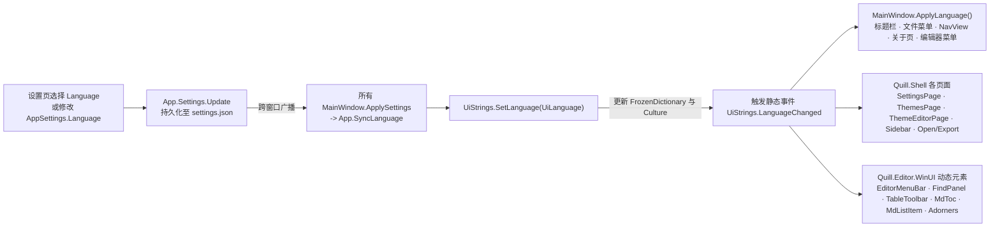

# 07 - 配置存储、85 槽主题、双语热切换与应用壳体

本章涵盖系统的最上三层：`Quill.Settings`（纯 .NET 配置/文件规约）、`Quill.Editor.WinUI` 主题及双语系统、`Quill.Shell`（可复用界面模块），以及 `Quill` 桌面应用外壳（非打包多窗口启动、Mica 视觉框架与独立发布包形态）。

---

## 7.1 `Quill.Settings`：无 UI 持久化、宏规划与资源管理器整合

`Quill.Settings` 刻意保持与核心相同的纯 `net10.0` 无 UI 属性，支持通过 `tests/Quill.Settings.Tests` 进行完整逻辑单测：

- **通用原子 JSON 存储（`JsonStore<T>`）**：采用临时文件 + `File.Move(..., overwrite: true)` 原子替换写入 `%LocalApplicationData%\Quill\settings.json` 与 `state.json`，每次更新均携带前/后快照触发 `StoreChangedEventArgs<T>` 事件。由于一个进程内全部打开的 `MainWindow` 共享同一个 `App.Settings` 和 `App.State` 实例，**任一窗口修改设置（如自动保存、阅读速度、暗亮主题、中英文语言），所有其他已打开窗口即时同步生效**。
- **`AppSettings` 与 `AppState`**：
  - `AppSettings`（[AppSettings.cs](../../src/Quill.Settings/AppSettings.cs)）管理启动行为（空白文档 / 上次文件夹 / 上次文件 / 指定文件夹）、默认扩展名与自定义扩展名校验、默认换行符（`CRLF`/`LF`）、切换文件前自动保存、拖放策略（文件夹 / Markdown 文件 / 其他文件）、图片插入规则（本地复制 + 宏展开 + 云端下载大小限制）、编辑器行为（括号配对、复制 Markdown 源码、无选区整行复制/剪切）、代码块显示（自动折行、行号、公式预览）、状态栏及阅读速度（WPM）、显示语言 `Language` 等。
  - `AppState` 记录全局界面记忆：侧边栏显隐/宽度（180–480 px）、当前 Tab（大纲 / 文件）、文件树视图模式（目录树 / 列表）、导航展开状态及最近路径。
- **图片拖放与路径宏引擎（`DropPlanner`、`ImageInserter`、`ImageFolderMacros`）**：完全以纯函数规划向编辑器拖入文件夹、`.md` 文档、本地图片、剪贴板位图或远程 URL 时的混合行为，并可展开诸如 `${filename}`、`${date}` 等目标路径宏，然后再由 `Quill.Shell/Insertion/EditorInsertions` 异步落盘或下载图片并向编辑器分发插入命令。
- **Windows 资源管理器右键“新建 Markdown 文档”（`ExplorerNewMenu`）**：通过封装 `IRegistry` 接口（生产实现 `WindowsRegistry` 操作 `HKCU\Software\Classes`，单元测试使用内存替身 `MemoryRegistry`），可从设置页一键注册或清理右键新建 `.md` 菜单项，无需管理员权限。

---

## 7.2 85 槽位主题系统（Themes & Theme Studio）

Quill 构建了一套强类型样式模型（位于 `Quill.Editor.WinUI/Theming/`）：

- **`MdStyleSheet`（85 个样式槽）**：用 `Color`、`float`、`string`、`Thickness`、`bool`、`int` 精准覆盖页面与正文、标题 1–6 缩放比与下划线、链接与行内元素、代码与公式块、引用块、列表缩进、表格边框与斑马纹、水平分隔线及错误/占位提示色。
- **双默认主题（`BuiltInThemes`）**：`Github`（浅色，对应 `MdStyleSheet.Light`）与 `Github Dark Dimmed`（深色，对应 `MdStyleSheet.Dark`），基础色彩与边距参数对齐 GitHub Primer。切换主题或调整选项时直接通过 `MdDocument.EffectiveStyleSheet` 重新下发 `BlockContext` 触发可视化层重绘，**从不导致文档模型重投影（0 次 FullProjection）**。
- **稀疏 Diff 用户主题保存（`ThemeStore` & `ThemeCatalog`）**：用户新建主题时只拷贝并派生自某一个内置基准主题（`BasedOn`），磁盘 `%LocalApplicationData%\Quill\Themes\<id>.json` **仅序列化与基准主题存在差异的槽位键值（`StyleSlots.Differences`）**。后续内置默认样式迭代升级时，用户自定义主题未改动的槽位能够自动继承平滑改善。
- **主题管理与编辑器（`ThemesPage` & `ThemeEditorPage`）**：左侧为分组可搜索（支持按中文或英文名实时检索）的 85 项控件表单，右侧挂载一个只读实时渲染对比预览区 `ThemePreview`，表单任意调节毫秒级联动右侧预览（支持直接勾选、配色选择与四边距编辑）。

---

## 7.3 运行时零重启双语热切换（Localization Architecture）

Quill 支持在 **English** 与 **简体中文（zh-CN）** 之间实时热切换，切换瞬间即完成所有已打开窗口、控件及内置提示文案更新，无需重启进程，同时对纯 .NET 核心领域零侵入。

### 架构设计与生命周期安全

- **资源承载（[UiStrings.cs](../../src/Quill.Editor.WinUI/Localization/UiStrings.cs)）**：中英两份覆盖 470 条 UI 键值（含格式化占位符如 `{0}`、`{1}`）的 JSON 表（`en.json` 与 `zh-CN.json`）编译为程序集嵌入式资源，启动时一次性反序列化进 `FrozenDictionary<string, string>`，运行期查找几乎零分配。
- **静态事件防泄漏契约**：因为 `UiStrings.LanguageChanged` 是进程级静态事件，所有 UI 控件（如 `EditorMenuBar`、`FindPanel`、`SidebarPanel`、`OutlinePanel`、`FilesPanel`、`SettingsPage`、`ThemesPage`、`ThemeEditorPage`、`OpenPage`、`ExportPage`、`WordCountButton`、`MdDocument`）一律在 **`Loaded` 中挂载并在 `Unloaded` 中精准解绑**（主窗口 `MainWindow` 在 `Closed` 中解绑），从而彻底杜绝关闭窗口或虚拟页面卸载后仍被静态事件根引用的内存泄漏。
- **菜单自定义额外项保活**：`EditorMenuBar` 在刷新和语言重建顶层菜单与子菜单项时，保持主窗口追加的 `View → Sidebar (Ctrl+Shift+L)` 额外菜单条目不丢失，并由窗口本地化通道就地刷新其译名。

---

## 7.4 `Quill.Shell` 与 `Quill` 非打包多窗口桌面壳体

### 模块解耦设计

之所以将全部页内页面和侧边栏放在独立类库 `src/Quill.Shell/`，而不是直接耦合进 `src/Quill/` 的 `Window` 子类中，是为了让无激活离屏测试宿主 `Quill.Playground` 也能直接把完整的 `SettingsPage`、`ThemesPage`、`ThemeEditorPage`、`OutlinePanel` 与 `FilesPanel` 挂载到后台舞台里运行真实交互自动化验证。

- **`SidebarPanel`（可调宽侧边栏）**：顶部以 CommunityToolkit `Segmented` 切换「大纲」与「文件」；`OutlinePanel` 折叠状态跨大纲重排自动记忆；`FilesPanel` 支持目录树懒展开与平铺列表切换，底层通过带 300ms 防抖延迟的 `FileSystemWatcher` 同步磁盘文件变化并保留树节点展开态与滚动条位置。
- **`MainWindow` 多窗口协作**：一个桌面进程支持无限个独立打开的窗口（`Ctrl+N` 新建窗口），窗口间共享内存级 `Settings`、`State` 和 `Themes` 存储；最后一个窗口关闭后退出进程。
- **扩展标题栏与卡片阴影框架**：利用 WinUI 3 `AppWindow` 扩展非客户区并将整个窗口顶部 48px 整合为统一控制工具栏（汉堡抽屉按钮、撤销、重做、侧栏切换、菜单栏与文档名/脏状态圆点指示），配合 `MicaBackdrop` 云母材质、DPI 与最小化零尺寸安全守卫（`WindowChrome`），呈现干净克制的 Windows 11 原生视觉体验。
- **外部修改检测与自动保存**：`FileChangeMonitor` 监听外部程序对当前磁盘文件的改写并在有未保存改动时弹窗询问重装或保留；`AutoSaver` 依设置延迟安全写入后更新标题栏干净态。

### 非打包运行与 Release 分发形态

Quill 采用 **`WindowsPackageType=None`** 模式运行，不强制要求用户打包/签名成 MSIX 商店包安装，即可使用文件选择器（传入 `AppWindow.Id`）和云母标题栏：

- **框架依赖 + WinAppSDK 自包含（推荐发布版）**：通过 `dotnet publish src/Quill/Quill.csproj -c Release -r win-x64 --self-contained false`（`Quill.csproj` 在 `-r win-x64` 发布时自动为其自身启用 `WindowsAppSDKSelfContained=true`，同时不影响所引用的类库项目）产出轻量绿色免安装压缩包。目标机器仅需已安装 **.NET 10 Desktop Runtime (x64)**，无需用户另行安装庞大的 Windows App SDK 单独运行时，所有 WinRT 激活类通过 `mt.exe` 合并进 `Quill.exe` 内嵌清单与并排 DLL 实现开箱即跑，并附带原生的 `Quill.ico`、`quill_native.dll` 及 KaTeX 字体资源。
