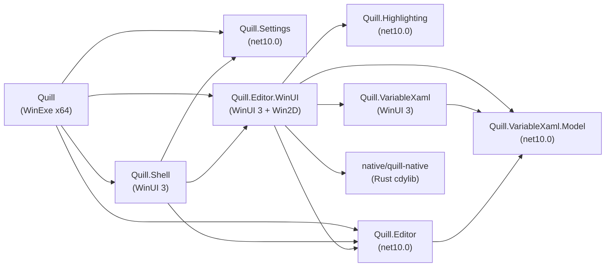

# Quill System Architecture Overview

> For the detailed 7-part Chinese technical deep dive, see [docs/README.md](../README.md).

## 1. Design Philosophy & Hard Invariants

Five architectural invariants govern every layer of the codebase:

1. **Strict Separation of Domain and UI (`Quill.Editor` vs. `Quill.Editor.WinUI`)**: `Quill.Editor` targets pure `net10.0` with zero dependency on WinUI, Win2D, XAML, or Windows Runtime types. All editing logic, transactions, cursor math, Markdown I/O, and incremental projection run headlessly in unit tests (`tests/Quill.Editor.Tests`).
2. **Single Source of Truth & Unidirectional Data Flow**: During editing, `EditorState` (owned by `EditorSession`) is the sole authority. The UI never mutates text or trees directly; keystrokes, IME commits, pointer drags, menu commands, and search replacements all dispatch immutable `Command` records into `EditorSession.Execute(Command)`.
3. **Immutable Trees with Structural Sharing**: Every `Document` and `Block` (`ContainerBlock`, `LeafBlock`, `AtomicBlock`) is a C# immutable `record` using `ImmutableList<Block>` and `ImmutableArray<LinePrefix>`. Editing a leaf copies only its path up to `Document`, leaving untouched sibling subtrees reference-equal across revisions.
4. **Lossless Round-Tripping without AST Leakage**: `Markdig` is strictly internal to `Quill.Editor.Markdown.Import`. Leaves store raw inline Markdown source (`Text`), blocks preserve structural metadata (`BlockSeparator`, `LinePrefixes`, `HeadingSyntax`, `FenceSyntax`, `ListSyntax`, `TableSyntax`), and `MarkdownSerializer` (`BlockWriter`) replays original formatting byte for byte on untouched regions.
5. **No $O(N)$ Keystroke Work**: On normal typing or undo/redo, full-document parsing and full-document serialization count must stay at zero (guarded by `OperationCounters`). Memoized projection (`DocumentProjector`), per-leaf incremental statistics (`WordStatistics`, `HeadingIndex`), and virtualized UI stacks (`BlockStackLayout`) bound per-keystroke work to the edited block and viewport.

---

## 2. Layered Dependency Topology

---

## 3. Core Architecture Layer by Layer

### 3.1 Document Model & Markdown I/O (`Quill.Editor`)

- **Block Tree + Leaf Source**: Containers (`Document`, `BlockQuote`, `ListBlock`, `ListItem`, `TableBlock`, `TableRow`, `FootnoteDefinition`) compose structural children, while `TextLeafBlock` subclasses (`Paragraph`, `Heading`, `TableCell`, `CodeLanguage`, `DefinitionSlot`) hold unrendered inline Markdown source with normalized `\n` newlines, and `RawTextBlock` subclasses (`CodeBlock`, `MathBlock`, `HtmlBlock`, `FrontMatter`, `SourceLine`) hold verbatim text. `ThematicBreak` and `TocBlock` are `AtomicBlock`s.
- **Grapheme & UTF-16 Offsets**: `TextBoundaries` snaps every editing cursor and selection offset (`TextPosition`) to UTF-16 grapheme cluster boundaries via `StringInfo`, preventing split surrogate pairs, CRLF splits, or broken emoji/combining marks.
- **Line-Prefix Splicing & Serialization**: Multi-line blocks inside block quotes or nested lists record physical line prefixes (`ImmutableArray<LinePrefix>`) on each leaf. `ReplaceTextStep` delegates line-prefix splicing to `LinePrefixSplice` so insertions/deletions and undos keep container indentation intact without re-parsing siblings. File decoding/encoding in `MarkdownFile` + `MarkdownFileCodec` tracks UTF-8, UTF-16 LE/BE, BOM flags, GB18030, and system legacy encodings with automatic UTF-8 fallback notification.

### 3.2 State, Commands, Behaviors & Reversible Transactions

- **Positions & Selections**: `Position` is either a `TextPosition(BlockId, Offset, Affinity)` inside a leaf (where `Affinity.Backward` vs `Forward` disambiguates whether the caret sits inside inline markers like `**a|**` or outside `**a**|` and soft-wrap line breaks) or a `BoundaryPosition(Parent, Index)` before/after child blocks. `TextSelection` supports collapsed carets, multi-block selections, and atomic `IsBlockCaret` selections.
- **Execution Pipeline**: `EditorSession.Execute(Command)` routes selection commands cleanly without touching `Document`, and routes editing commands through `BehaviorRegistry` (`DefaultBehaviors`) to produce a `Transaction` containing forward `Step`s, exact inverse `Step`s (`ReplaceTextStep`, `ReplaceChildrenStep`, node replacements, etc.), and pre/post selections.
- **Undo & Commit Model**: Consecutive `TransactionKind.Typing` or `Deletion` edits in the same leaf merge inside `UndoHistory` within time/word thresholds, while `InputRule` conversions (e.g., `# ` becoming a Heading) and `Commit` operations (re-parsing dirty multi-block paragraphs when leaving a block) stay separate undo entries so `Ctrl+Z` reverts one logical conversion at a time.

### 3.3 Two-Phase Projection & Incremental UI Reconciliation

- **Projection (`DocumentProjector`)**: Maps immutable `EditorState` -> `ProjectionResult` (`VNode` root, `PositionMap`, `ActiveSet`, `SelectionInfo`, `ProjectionStatistics`). Activation decides which block and inline markers expand around `ActivationHead` (frozen during pointer drags or IME compositions). Unchanged leaves reuse their cached inline parse trees (`InlineTree`) and VNodes by reference; unchanged containers are never entered.
- **`VariableXamlRoot` & `Reconciler`**: Takes immutable `VNode` trees and performs reference-equality skipping (`ReferenceEquals`) and structural hash (`IStructuralHash` / `NodeHash`) short-circuiting. Live WinUI controls stay mounted at unchanged tree slots (`IVirtualLifecycle` notifies `OnBlockUnmounted` / context updates), preserving focus, composition, and animations. Top-level blocks sit in a virtualized collection bridged through `VirtualStackHandler` and `VirtualItemCollection`.

### 3.4 Virtualized Stack Layout & Win2D Self-Drawn Controls

- **`BlockStackLayout` & `PrefixSums`**: A WinUI `VirtualizingLayout` maintaining measured block heights by key and unmeasured height estimates via `BlockHeightEstimator`, backed by a Fenwick/prefix-sum tree (`PrefixSums`) for $O(\log n)$ top-offset queries and viewport binary search (`IndexAt`). Detached off-viewport blocks can be measured synchronously on demand via `XamlLayoutService` without keeping the whole document realized in the visual tree.
- **Win2D Rendering (`MdBlockView` & `BlockTextLayout`)**:
  - `BlockTextLayout` configures DirectWrite uniform line spacing (`CanvasLineSpacingMode.Uniform`) weighted around font metrics (CSS half-leading) on plain/inline-marker lines so toggling markdown syntax markers never vertically shifts the baseline, while allowing tall objects (`InlineBox` images/formulas) proportional breathing room.
  - Inline monospace code pill bounds are calculated from actual DirectWrite ink metrics (cached in `InkMetricCache`) rather than loose em-box bounds.
  - `MdBlockView.Draw` paints invalidated regions of `CanvasVirtualControl` into an integer-pixel-snapped `(0, 0)`-origin `CanvasRenderTarget` first and blits via `CanvasImageSource`/`NearestNeighbor`/`Copy`, eliminating sub-pixel glyph shimmer when dragging selections over tile seams while preserving opaque-background ClearType rendering.
- **Math, Diagrams & Code Highlighting**:
  - `MathTypesetter` wraps native `RaTeX` with a 512-entry LRU cache (`RatexMode.Display` / `Inline`) and pre-warms in a background task.
  - `MermaidNative` P/Invokes `quill_mermaid_render` in `native/quill-native` (`mermaid-rs-renderer` + `usvg` system font path resolution), outputting Direct2D-safe simplified SVG rasterized via Win2D `CanvasSvgDocument`.
  - `SourceHighlighting` + `CodeHighlighting` tokenize fences and source-mode lines asynchronously using `Quill.Highlighting` (`GrammarCatalog` + `TextMateSharp`).

### 3.5 Input, IME, Source Mode & Search

- **`MarkdownBox`**: Connects WinUI `KeyDown`, `CharacterReceived`, pointer gestures (`PointerGestures`), drag/drop (`MarkdownBox.Insertions.cs`), and `CoreTextServiceContext` (`CoreTextEditContext` singleton reuse). During active TSF/IME updates, `TextInputController` sets `IsUpdating` to defer view reflow and `Changed` events safely until the composition transaction completes, preventing CoreText re-entrancy crashes.
- **Source Mode (`SourceMode` / `SourceSession`)**: Switches cleanly between rich block trees and flat `SourceLine` blocks preserving original line-ending formatting and scroll synchronization, updating the underlying document on exit.
- **Find & Replace (`DocumentSearch` & `SearchController`)**: Pure-`.NET` incremental regex/case/whole-word search + `FindPanel` overlay, highlighted directly inside each realized `MdBlockView` via `IMatchSource`.

### 3.6 Settings, Themes, Localization & App Shell

- **Shared Persistence (`Quill.Settings`)**: `SettingsStore` and `AppStateStore` derive from atomic `JsonStore<T>` so every open `MainWindow` shares and reacts to settings (`AutoSave`, `MatchBrackets`, themes, startup behavior, drop/image rules, `Language`) and window state immediately.
- **Theme System (`MdStyleSheet` & `ThemeCatalog`)**: 85 typed slots across 8 `ThemeGroup`s (`StyleSlots`). User themes store only sparse diffs against a built-in base (`ThemeFile`) under `%LocalApplicationData%\Quill\Themes\`.
- **Zero-Restart Localization (`UiStrings`)**: Embedded `en.json` and `zh-CN.json` tables loaded into `FrozenDictionary<string, string>` power live switching via `UiStrings.LanguageChanged`. Every window, menu, dialog, page, theme editor, and dynamic editor ornament (`FindPanel`, `TableToolbar`, `MdListItem`, `MdToc`, `MdCodeLanguage`) refreshes in place and unsubscribes on `Unloaded` / `Closed`.
- **Unpackaged Deployment (`WindowsPackageType=None`)**: Extends WinUI 3 with Mica backdrop and custom caption chrome (`WindowChrome`), shipping as a framework-dependent `.NET 10` executable with `WindowsAppSDKSelfContained=true` side-by-side WinRT activation manifests.
